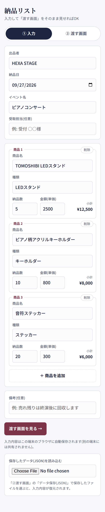
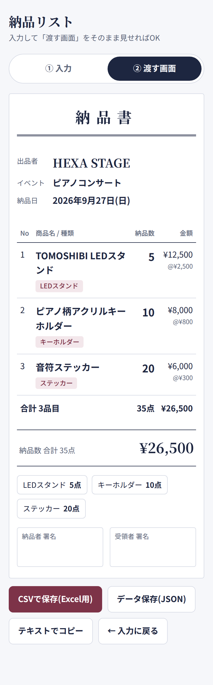
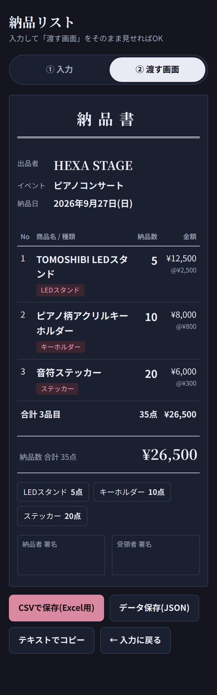

# HEXA delivery — 納品リスト

イベントやマルシェで商品を委託・納品するときに使う、**納品書づくりのためのWebアプリ**です。
スマートフォンで商品名や数量を入力すると、受け取る方にそのまま画面を見せられる「納品書」ができあがります。

紙の納品書を手書きする手間を減らし、「何を・いくつ・いくらで」お渡ししたのかを、その場でお互いに確認できるようにすることを目指して作りました。

**▶ アプリを開く：https://tsuchicco0113-png.github.io/HEXA-delivery/**

インストールや会員登録は必要ありません。上のURLをブラウザで開くだけですぐにお使いいただけます。

## 画面イメージ

| ① 入力画面 | ② 渡す画面 | ② 渡す画面(ダークモード) |
|:---:|:---:|:---:|
|  |  |  |

## こんなときに

- ピアノコンサートやイベント会場の物販に、商品を納品するとき
- マルシェやお店に、作品を委託でお預けするとき
- 納品した内容を、あとから一覧(Excel)で確認したいとき

## 使い方

### 1. 基本情報を入力する

「① 入力」画面で、次の項目を入力します。

| 項目 | 内容 |
|---|---|
| 出品者 | お店の名前や屋号(例: HEXA STAGE) |
| 納品日 | 最初から今日の日付が入っています |
| イベント名 | 例: ピアノコンサート |
| 受取担当 | 受け取る方のお名前(空欄でもかまいません) |

### 2. 商品を入力する

商品ごとに **商品名・種類・納品数・金額(単価)** を入力します。

- 商品を増やすときは「＋ 商品を追加」を押してください。
- 「種類」は候補(LEDスタンド、キーホルダー、ステッカーなど)から選べます。候補にないものは自由に入力できます。
- 小計は入力と同時に自動で計算されます。
- 最初はサンプルの商品が入っています。画面上部の「全部消して新規」を押すと、空の状態から始められます。

### 3. 受け取る方に画面を見せる

「渡す画面を見る →」を押すと、納品書の形に整った画面に切り替わります。
この画面をそのまま受け取る方に見せて、内容を一緒に確認してください。

納品書には次の内容が表示されます。

- 出品者・イベント名・納品日
- 商品ごとの 納品数・金額(単価と小計)
- 合計の点数と合計金額
- 種類ごとの点数
- 納品者・受領者の署名欄

### 4. データを保存する(必要に応じて)

「② 渡す画面」の下にあるボタンで、内容を保存・共有できます。

| ボタン | できること |
|---|---|
| CSVで保存(Excel用) | Excelで開ける表として保存します。日本語も文字化けしません。 |
| データ保存(JSON) | 入力内容をそのまま保存します。別の端末に移すときや、あとで入力し直したいときに使います。 |
| テキストでコピー | LINEやメールに貼り付けられる文章としてコピーします。 |

保存したJSONファイルは、「① 入力」画面のいちばん下にある「保存したデータ(JSON)を読み込む」から読み込むと、入力内容を復元できます。

## ご利用にあたって

- **入力内容の保存先について**
  入力した内容は、お使いの端末のブラウザの中に自動で保存されます。ページを閉じても、同じ端末・同じブラウザで開き直せば続きから使えます。
  ほかの端末とは共有されないため、端末を変えるときは「データ保存(JSON)」をご利用ください。
- **個人情報・データの送信について**
  入力した内容がインターネット上のサーバーに送信されることはありません。すべての処理はお使いの端末の中だけで行われます。
- **ブラウザのデータを消去した場合**
  ブラウザの履歴やサイトデータを消去すると、保存されていた入力内容も消えます。大切なデータは、あらかじめCSVやJSONで保存しておくことをおすすめします。
- **イベント前日の準備がおすすめです**
  当日あわてないように、使う端末で前日のうちに入力を済ませておくと安心です。

## ファイル構成

```
index.html   アプリ本体(HTML / CSS / JavaScript を1つのファイルにまとめています)
docs/        README用の画面イメージ
README.md    このファイル
```

`index.html` をダウンロードして、パソコンやスマートフォンで直接開いてもお使いいただけます。
文字のフォントは Google Fonts(Shippori Mincho / Zen Kaku Gothic New)を使っています。インターネットにつながっていないときは、端末の標準フォントで表示されます。

## GitHub Pages での公開手順(管理者向け)

1. https://github.com/tsuchicco0113-png/HEXA-delivery/settings/pages を開く
2. Source を「Deploy from a branch」にし、Branch で `main` と `/ (root)` を選んで Save
3. 数分待つと上記 URL でツールが開けるようになります

---

HEXA STAGE ／ 滋賀県甲賀市土山町
